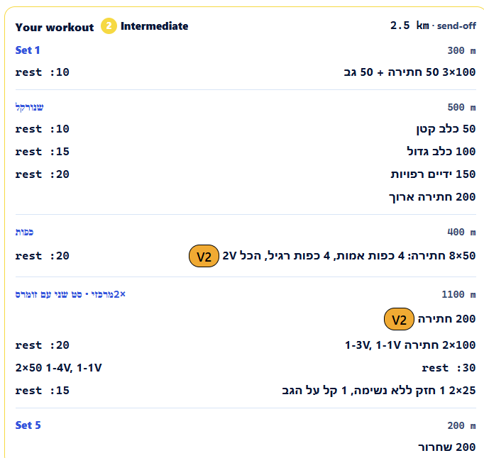

# Печать тренировки крупным шрифтом (кнопка Print у workout)

> План от 26.11.2026, ответы Влада на §7 — того же дня. Код не написан. Статус фазы — в
> [`../ROADMAP.md`](../ROADMAP.md) (8.19). Поток тренера, откуда берётся workout, —
> [`trainings-coach-flow-plan.md`](trainings-coach-flow-plan.md) §5.5 (CF6); занесение листа тренера —
> [`../workouts/README.md`](../workouts/README.md).

## 0. Задача

Влад: «в принте будут варианты view, но пока делай обычный один с большим фонтом, используя
место как можно лучше для большого фонта». Лист A4 с тренировкой вешают у бортика — его читают
из воды, с 1–3 м. Сейчас нужен **один** вид печати (`large`): тренировка одного уровня на **одном**
книжном листе A4, всегда в две колонки — главный сет справа, остальные слева, — максимально
крупным шрифтом. Архитектура — с местом под другие виды позже.

Блок сегодня на проде (занятие 26.11 19:45, группа dolphin-netanya-masters, режим «👁 View»):



(Тот же блок, снятый агентом в панели браузера, — [`workout-print/prod-2026-11-26-view-mode.png`](workout-print/prod-2026-11-26-view-mode.png).)

Что видно на скриншоте и важно для печати:
- шапка «Your workout · ② Intermediate» и «2.5 km · send-off»;
- 5 сетов, у каждого метры справа (`300 m`, `500 m`…); у сета с повтором — «×2» перед названием;
  главный сет — «×2 מרכזי · סט שני עם זומרס», 1100 m;
- строки на иврите идут справа налево, правая колонка ячейки уровня (`send_off`) — **слева**:
  в ней не только время выхода, но и «rest :10» (тренер пишет отдых в ту же ячейку). На листе —
  «R:10» (§3.2, В3);
- строка без иврита («2×50 1-4V, 1-1V») идёт слева направо, и её «rest :30» уезжает **вправо** —
  колонка времени прыгает. На листе такого не будет (§3.4); на сайте — отдельной задачей позже;
- нагрузка — чипы «V2» (оранжевая заливка `UI_IntensityIcon`).

## 1. Что есть в коде

| Что | Где |
|---|---|
| Блок «Your workout» (карточка с рамкой цвета уровня, шапка, км) | `client/src/projects/hub-groups-project/components/trainings/next/lane-block.tsx` → `YourWorkout` (стр. ~139); рисуется в `YourLane` (телефон) и в конце `FullPool` (десктоп) |
| Тело workout только для чтения (сеты, строки, время) | `…/trainings/workout/workout-level-view.tsx` (`WorkoutLevelView`, `SetBlock`) |
| Подпись строки «4×100 текст V2» с bidi-изоляцией | `…/workout/workout-line-label.tsx`; чистые функции — `workout-format.ts` (`repsDistanceLabel`, `lineDir`, `intensityKeys`, `cellLabel`) |
| Метры | `…/workout/workout-totals.ts` (`setMeters`, `levelMeters`, `formatKm`, `formatMeters`) |
| Версия уровня | `…/workout/workout-for-level.ts` (`workoutForLevel` — зеркало серверного `WorkoutRules.ForLevel`) |
| Превью тренера «what a lane gets» (выбор уровня) | `…/workout/workout-preview.tsx` (внутри `workout-editor.tsx`, режим ✎ Edit) |
| Типы | `client/src/projects/hub-groups-project/types.ts`: `Workout`, `WorkoutSet`, `WorkoutLine`, `WorkoutCell`; сервер — `server/Swimm.Application/Dtos/WorkoutDtos.cs` |
| Хранение | `Sys_LanePlans.Workout` — **один JSON-документ** (`LanePlan.Workout`, строка): новое поле сета — это поле DTO и типа, без миграции |
| Данные участника | `lane.level_workout` в `lane_view` ответа RSVP; сервер кладёт версию уровня **только на свою дорожку зрителя**, управляющему — на каждую (`server/Swimm.Application/Mapping/TrainingLaneView.cs`, `workoutOnEveryLane`) |
| Данные тренера | весь workout — `useSessionWorkout` (`GET/PUT …/lane-plans/{sessionId}/workout`) |
| `?session=<id>` | рабочий стол тренера (`trainings-context.tsx`, `SESSION_PARAM`); прошедшие занятия (CF9) — тот же стол |
| Прецедент «вариантов вида» | обложки My media: `my-media-project/cover/layouts/cover-a|b|c.tsx` + выбор в диалоге; `my-media-project/print/` — плакат картинкой (это PNG-экспорт, не печать на бумагу) |
| Тесты клиента | `npm --prefix client test` → `node --test "src/**/*.test.mjs"`, TS через `workout/ts-resolve-hook.mjs` (пример — `workout-model.test.mjs`) |

`@media print` и `window.print` в клиенте **не используются нигде** — печать с нуля.
Шрифты сайта — Inter и JetBrains Mono (Google Fonts), **иврита в них нет**: иврит сейчас рисуется
системным фоллбеком. Для подгонки это важно (§3.6).

**Признака «главный сет» в модели workout нет.** `★ KeySetNo` (8.16) — другое: метка ключевого
сета у записи ленты тренировок (`TrainingSession`), к workout плана дорожек не относится. Как
определяем главный сет — §3.3.

## 2. Как печатать — решение

**Р1. Лист печати — в окне предпросмотра на той же странице, без нового маршрута.**

Кнопка Print открывает полноэкранное окно «Print preview»: лист A4 в масштабе под экран и кнопки
`Print` / `Close` (позже — выбор вида). `Print` вызывает `window.print()`; на время печати
печатается **только лист**: он стоит порталом прямым ребёнком `<body>`, а правило печати прячет
всё остальное.

Почему не другие варианты:

| Вариант | Минус |
|---|---|
| `@media print` поверх самой страницы | тема deep (тёмный фон, карточки, липкие полосы), адаптивные варианты телефон/десктоп, табы — всё это пришлось бы гасить правилами; подогнать шрифт под лист нельзя, пока блок живёт в колонке страницы |
| Отдельный маршрут `/groups/{slug}/print/…` | новый html-вход Vite, три зеркала чистых URL (`routes.ts`, `vite.config.js`, `Program.cs`) + `PublicSite.cs`, решение про поиск (`noindex`, robots — пункты 4 и 15 `docs/pre-push-rules.md`), повторная загрузка данных и повторная проверка прав. Плюс у него один — ссылкой можно поделиться, но печатают с того же устройства, где смотрят |
| Окно `window.open` со своей разметкой | блокировщики всплывающих окон, стили и шрифты нужно копировать в чужой документ, на телефоне — новая вкладка |

Плюсы Р1: данные уже на экране и уже обрезаны сервером по правам; маршрутов, сервера и миграций
нет; человек видит лист до печати; та же точка входа потом даст выбор вида.

Что учтено:
- **чистые URL** — не трогаем; `?print=` в адрес не пишем (В9 — нет);
- **тема deep** — рамка окна предпросмотра на токенах deep (`--deep-*`, `--t-*`), сам лист —
  всегда белый с чёрным, в любой теме и режиме light/dark;
- **RTL** — §3.4;
- **видимый UI на английском** — `Print`, `Print preview`, `Close`, подписи на листе «R:», «km», «m»
  английские; название группы, сетов и текст строк — данные, как есть (иврит).

## 3. Вид `large`: лист и подгонка шрифта

### 3.1 Геометрия

- Только **книжный A4** (В4). Лист — блок фиксированного размера в CSS-пикселях: 210×297 мм =
  **794×1123 px** (96 px/дюйм).
- `@page { size: A4 portrait; margin: 0 }` — нулевое поле страницы убирает колонтитулы браузера
  (адрес, дата) без галочек в диалоге печати; отступ **10 мм (38 px)** делаем внутри листа —
  принтеры не печатают у самого края (обычно 3–5 мм).
- Рабочая область: 718×1047 px. Две колонки по (718 − 24) / 2 = **347 px** с промежутком 24 px
  (тонкая вертикальная черта посередине — по пробной печати).
- Лист **всегда один** (В6): второго листа у вида `large` нет.
- `@page` нельзя ограничить областью: стиль `<style id="wprint-page">` вставляем перед `print()`
  и убираем на `afterprint` **и** при закрытии окна (Android Chrome возвращается из `print()`
  сразу, iOS шлёт `afterprint` с задержкой).

### 3.2 Что на листе

Сверху вниз:
1. **Шапка-полоса** во всю ширину (одна строка, шрифт 0.55 от основного, не меньше 12 px):
   **название группы** (иврит — данные) · **уровень** `② Intermediate` (кружок ранга контуром) ·
   **км** `2.5 km` (В5). Дата·время, номер дорожки, адрес сайта, QR — «потом решим» (§7, В5).
2. **Заметка тренера** (`workout.note`), если есть — во всю ширину над колонками, обычным весом.
3. **Две колонки** (§3.3): правая — главный сет, левая — остальные сеты по порядку сверху вниз.
4. **Сет.** Шапка — `2× ` + название со стороны начала строки, метры сета с другой стороны;
   над каждым сетом колонки, кроме первого, — жирная чёрная черта (2 px). Шапка сета — 0.8 от основного.
5. **Строки.** Две части: подпись строки (растягивается, переносится по словам) и ячейка уровня
   (`send_off`, со своими повторами — «3× 1:45», как `cellLabel`). Ширина ячейки — **одна на весь
   лист** (по самой широкой ячейке), моноширинные цифры — все времена стоят столбиком.
6. **Отдых** — «**R:30**» вместо «rest :30» (В3): `restLabel(cell)` — чистая функция, ячейка вида
   `rest :30`, `Rest:30`, `rest 0:30` → `R:30`, `R:0:30`; всё остальное («1:45», «3× 1:45») — как есть.
   Только на листе; на сайте — отдельной задачей позже.
7. **Нагрузка** «V2», «1-3V» → чипы `V1 V2 V3` **контуром**: чёрный текст, рамка 0.08em, скругление,
   без заливки (свой маленький `PrintIntensity`, а не `UI_IntensityIcon`: тот цветной и открывает
   шкалу по нажатию). Не по шкале — текстом, как на сайте.

Подвала нет (лист один). Цвета: всё `#000` на `#fff`, цвет уровня и акценты не используем;
строки внутри сета разделяем тонкой чертой 0.5 px или просто интервалом (решится в Ш3 по пробной печати).

### 3.3 Колонки и подгонка размера

**Раскладка — не по высоте, а по смыслу (В2):** правая колонка — главный сет (תרגיל מרכזי),
левая — все остальные сеты в порядке листа. В ивритском листе 26.11: справа «×2 מרכזי · סט שני
עם זומרס» (1100 m), слева Set 1, שנורקל, כפות, Set 5. «Правая» — физически правая сторона листа,
независимо от направления текста.

**Как определяется главный сет** — `pickMainSets(workout, levelId)`, чистая; по умолчанию (В11):
1. **По названию:** сеты, в `title` которых есть `מרכזי` (а также `עיקרי`, `main` без учёта регистра).
   Так тренер подписывает главный сет на листе («מרכזי»), и разбор листа название сохраняет.
2. **Нет такого — по метрам:** сет с наибольшими метрами этого уровня (`setMeters`), **кроме первого
   и последнего** (разминка и заминка), если сетов ≥ 3; при равенстве — первый из них. Проверено на
   листе 22.11 (`docs/workouts/sheets/2026-11-22-2000.txt`): разминка там — 900 m, не короче
   остальных сетов ни на одном уровне, и без исключения она стала бы «главной»; с исключением
   кандидат один — «זומרס» (последний сет «כפות» — заминка по правилу). На 26.11 правило по
   метрам дало бы тот же «מרכזי» (1100 m).
3. **Два и больше по названию** — все они справа, по порядку сверху вниз; слева — остальные.
4. **Одна колонка пустая** (сет всего один, или все сеты главные) — непустая колонка занимает всю
   ширину листа: пустая половина отняла бы у шрифта вдвое (В12).

Потом, если эвристики мало (В11): явная метка `main` у сета — ★ в редакторе workout, разбор листа
ставит её сам по «מרכזי». Поле в JSON-документе workout (`WorkoutSetDto` + `WorkoutRules.ForLevel` +
тип клиента), миграции не нужно. Тогда `pickMainSets` сперва смотрит на метку, эвристика — запасная.

**Подгонка — один размер `f` на весь лист**, всё остальное в `em` от него:

```
f* = наибольший f из [F_FLOOR, F_MAX] с шагом 0.5 px, при котором fits(f)   — бинарный поиск, ~8 замеров
fits(f):
  отрисовать лист в скрытом контейнере с размером f и замерить:
  высота шапки + заметки + max(высота левой колонки, высота правой) ≤ 1047 px
  и нет горизонтального переполнения (длинное слово шире колонки)
```

- `F_MAX = 96 px` (72 pt). Нижней «удобной» границы, после которой идёт второй лист, нет (В6):
  шрифт уменьшается, пока всё не влезет, до технического пола `F_FLOOR = 10.7 px` (8 pt).
- **Не влезает и на полу** (около 90+ строк уровня — на реальных листах такого не было): лист
  печатается с полом, низ длинной колонки обрезается, а в окне предпросмотра — предупреждение
  «Too long for one page — the bottom is cut off» с кнопкой Print, которая всё равно работает (В13).
  Предпросмотр показывает выбранный размер: «Font 28 pt».
- Самая высокая колонка решает всё: если главный сет короче суммы остальных, справа останется
  пустое место — это цена правила «главный справа», а не ошибка подгонки.
- Замер — в `useLayoutEffect` **после `document.fonts.ready`**: иначе меряется фоллбек-шрифт и лист
  при печати вылезает за край. Контейнер замера — тот же компонент вида, `position: fixed;
  left: -10000px; visibility: hidden`, той же ширины.
- Бинарный поиск полагается на то, что высота растёт с `f`; переносы строк делают рост ступенчатым,
  но не обратным. Страховка: после выбора — финальный замер выбранного `f`; не влез — шаг вниз.
- Подгонка — отдельно от вида: чистое ядро `searchFontSize(fits, opts)` получает функцию проверки,
  поэтому тестируется с поддельной `fits`, а DOM-часть (`useSheetFit`) — тонкая обёртка.

### 3.4 Направление (RTL)

- **Направление листа** — `sheetDir(workout)`: строк с ивритом больше, чем строк с латиницей (среди
  строк с текстом) → `rtl`, иначе `ltr`. Лист 26.11 — `rtl`. Направление листа решает раскладку
  **строк**, а не колонок: колонки — главный справа всегда (§3.3).
- Строка раскладывается **по направлению листа**, а не по своему: подпись — со стороны начала,
  ячейка уровня — с противоположной. Внутри подписи — те же изоляты, что в `WorkoutLineLabel`
  (`<bdi dir="ltr">` для «4×100», текст со своим `lineDir`), чтобы «4×150» не стало «150×4».
- Итог: в ивритском листе «R:30» строки «2×50 1-4V, 1-1V» стоит **в той же левой части строки**,
  что и остальные ячейки.

### 3.5 Что убирается при печати

Всё, кроме листа: шапка сайта, табы, липкие полосы, бассейн, окно предпросмотра и его кнопки —
правило `html.wprint-on body > :not(#wprint-root) { display: none !important }` под `@media print`;
класс `wprint-on` ставится на `<html>` на время жизни окна предпросмотра. Фон, тени, цвета, рамка
карточки цветом уровня — на листе их нет изначально (лист рисуется своим видом, а не копией
карточки), поэтому `print-color-adjust` не нужен.

### 3.6 Шрифт

**Системный** (В8): стек `Inter, 'Segoe UI', Arial, 'Noto Sans Hebrew', sans-serif`, вес 800;
ячейки — `'JetBrains Mono', Consolas, monospace` с `font-variant-numeric: tabular-nums`. Иврит
берётся системным шрифтом устройства; замер идёт на том же устройстве, что печатает, — подгонка
честная. После пробной печати решаем, нужен ли Heebo/Assistant 800 только для печати.

## 4. Шов под будущие виды

```ts
// workout/print/print-types.ts
/** Что печатаем — не зависит от места кнопки и от вида. */
export interface WorkoutPrintSource {
  workout: Workout;            // уже версия уровня (level_workout / workoutForLevel), один уровень (В1)
  levelId: number | null;
  level: { rank: number; name: string } | null;
  groupName: string;
  // дата/время занятия — не нужны виду large (В5); добавятся, когда понадобятся другому виду
}
export type WorkoutPrintViewId = 'large';     // потом: 'all-levels', 'compact', 'two-up', 'card'…
export interface WorkoutPrintView {
  id: WorkoutPrintViewId;
  label: string;                               // английский: 'Large'
  orientation: 'portrait' | 'landscape';       // large — portrait (В4)
  /** Лист вида; подгонку вид делает сам (через общий useSheetFit или свою). */
  Sheet: React.FC<{ source: WorkoutPrintSource }>;
}
// workout/print/print-views.ts
export const PRINT_VIEWS: Record<WorkoutPrintViewId, WorkoutPrintView> = { large: LARGE_VIEW };
export const DEFAULT_PRINT_VIEW: WorkoutPrintViewId = 'large';
```

- **Где выбор:** в окне предпросмотра, сегментом `View` (тот же `SegmentBar`, что в превью тренера).
  Пока вид один — сегмента нет. Последний выбор — в `localStorage` (`swimm.workoutPrint.view`).
- Новый вид = файл `views/<id>-view.tsx` + строка в `PRINT_VIEWS`; кнопки и окно не меняются.
  Правило «один лист», раскладка «главный справа» и «R:» — свойства вида `large`, не общего шва:
  другой вид может печатать на нескольких листах или раскладывать иначе.
- Вид «все уровни» (тренеру — лист на каждый уровень) получит `Workout` целиком: на этот случай в
  `WorkoutPrintSource` потом добавится необязательное `allLevels`, без ломки `large`.

Раскладка файлов (правило «чистый код мелкими файлами»), всё в
`client/src/projects/hub-groups-project/components/trainings/workout/print/`:

| Файл | Что |
|---|---|
| `print-types.ts` | типы выше |
| `print-sheet-model.ts` | чистое: `toSheetModel(source)` → шапка, левая и правая колонки, строки (подпись по частям, ячейка, чипы), `sheetDir`, `pickMainSets`, `restLabel`, метры сета и итог (через `workout-totals.ts`) |
| `print-fit.ts` | чистое: `searchFontSize`, константы `F_FLOOR/F_MAX`, размеры A4 и колонок |
| `use-sheet-fit.ts` | DOM: скрытый замер, `fonts.ready`, вызов `print-fit`, флаг «не влезло на полу» |
| `print-mode.ts` | `<html>.wprint-on`, вставка/уборка `@page`, `afterprint` |
| `workout-print-dialog.tsx` | окно предпросмотра: лист в масштабе (`transform: scale`), размер шрифта, предупреждение, `Print`, `Close`, позже `View` |
| `print-button.tsx` | кнопка `Print` (телефон — значок с `aria-label="Print workout"`) |
| `print-views.ts` | реестр видов |
| `views/large-view.tsx` (+ `large-sheet-parts.tsx` при росте) | вид `large` |
| `print-intensity.tsx` | чип нагрузки контуром |
| `workout-print.css` | `@media print` и стили листа, всё под `.wprint` |
| `print-sheet-model.test.mjs`, `print-fit.test.mjs` | юнит-тесты |

## 5. Кто видит кнопку и где она

- **Все, кто видит workout** (В10). Прав нет новых: кнопка стоит только там, где workout уже
  показан; данные уже обрезаны сервером (участнику — версия своей дорожки, управляющему — любой).
  Гость workout не видит — и кнопки нет.
- **Печатается один уровень** (В1) — тот, что показан:
  - **участник / тренер в «👁 View»:** шапка карточки `YourWorkout`, справа после «2.5 km · send-off»;
    уровень дорожки;
  - **тренер в «✎ Edit»:** шапка `WorkoutPreview` («Preview · what a lane gets») — уровень, выбранный
    в сегменте. Это то место, откуда тренер печатает лист для бортика.
- **Прошедшие занятия (CF9)** — тот же стол и те же блоки, кнопка появляется сама.
- **Телефон:** значок 🖨 без подписи (36×36 зона нажатия), окно предпросмотра во весь экран,
  лист уменьшен по ширине. `window.print()`: Android Chrome — системный диалог (принтер / PDF);
  iPhone Safari — лист «Печать/Поделиться». ⚠ С экрана «Домой» (PWA, им пользуются ради push)
  `window.print()` на iOS может молча не сработать. **Потом, не в этой работе** (В7): подсказка в
  окне «To print, open this page in Safari» — когда проверим на телефоне, что печать там правда
  не открывается.

## 6. Шаги

Модель — по правилу «Opus где развилки, Sonnet где точная спецификация». Каждый шаг — отдельный
подчат; шаги 1 и 2 независимы и могут идти параллельно.

| Шаг | Что | Готово, когда | Оценка | Кто |
|---|---|---|---|---|
| Ш0 | Ответы Влада на §7 | ✅ 26.11 (В1–В10); открыты В11–В13 с умолчаниями — можно идти | — | Влад |
| Ш1 | `print-types.ts`, `print-sheet-model.ts` (`pickMainSets`, `restLabel`, `sheetDir`, колонки), `print-fit.ts` (`searchFontSize`) + тесты (§8) | `npm --prefix client test` зелёный; функции без DOM | 2.5–3 ч | Sonnet по этому плану (правила §3.2–3.4 точные) |
| Ш2 | `print-mode.ts` + `workout-print.css`: портал, класс на `<html>`, `@page`, `afterprint`, уборка при закрытии | в Chrome печать в PDF даёт только лист, без колонтитулов; после закрытия окна страница печатается как раньше | 2 ч | Opus (различия браузеров) |
| Ш3 | `views/large-view.tsx`, `print-intensity.tsx`, `use-sheet-fit.ts`: вид и подгонка | лист 26.11 — 1 страница, «מרכזי» справа, шрифт ≥ 28 px; длинная тренировка (30+ строк) — тоже 1 страница, без обрезки; искусственная огромная — предупреждение | 3.5–4 ч | Opus (bidi, замер, шрифт) |
| Ш4 | `workout-print-dialog.tsx`, `print-button.tsx`, `print-views.ts`; кнопки в `YourWorkout` и `WorkoutPreview` | кнопка видна участнику, тренеру в View и Edit, на телефоне значком; гостю нет | 2–3 ч | Sonnet |
| Ш5 | Проверка вживую (§8.2) + записи в ui-kit (короткий / средний / длинный лист) | PDF 3 фикстур приложены к PR; Влад распечатал реальный лист | 2 ч | Opus + Влад (бумага) |
| Ш6 | Доки: раздел «Печать» в `docs/workouts/README.md`, строка в `docs/ui-components.md` (если лист станет общим компонентом), ✅ в ROADMAP 8.19, статус здесь | — | 0.5 ч | тот, кто делает Ш5 |

Итого ≈ 12.5–14.5 ч (было 14–17: ушли пагинация, раскладка колонок по высоте и альбомный лист).
Миграций, серверного кода, маршрутов нет — пункты `pre-push-rules.md` про маршруты, кэш и админку
не задеваются. Метка `main` у сета (В11) — отдельный шаг потом, если понадобится (≈2 ч: DTO,
`ForLevel`, тип, ★ в редакторе, разбор листа; без миграции).

## 7. Решения Влада и открытые вопросы

### Решено 26.11.2026

| # | Вопрос | Ответ Влада |
|---|---|---|
| В1 | Тренер печатает один уровень или все уровни сразу? | **один уровень** (выбранный) |
| В2 | Колонки в ивритском листе | **всегда две колонки: главный сет (תרגיל מרכזי) — в правой, остальные — в левой**, по порядку сверху вниз (§3.3) |
| В3 | «rest :30» на листе | пишется **«R:30»**; ячейка у строки без иврита — в той же части строки, что у остальных. На сайте — отдельной задачей позже |
| В4 | Альбомный лист | **только книжный A4** |
| В5 | Что в шапке | **группа, уровень, км**. Дата·время, номер дорожки, адрес сайта, QR — **потом решим** |
| В6 | Минимальный шрифт и второй лист | вид **всегда на одном листе**: второго листа нет, шрифт уменьшается, пока всё не влезет (§3.3) |
| В7 | iPhone с экрана «Домой» | подсказку «open in Safari» записать, **пока не делать** (§5) |
| В8 | Шрифт для иврита | **системный**; решить после пробной печати |
| В9 | Ссылка «сразу на печать» `?print=` | **нет** |
| В10 | Кто видит Print | **все, кто видит workout** |

### Открыто — можно идти с умолчанием

| # | Вопрос | Умолчание |
|---|---|---|
| В11 | Как узнавать главный сет: эвристика (название «מרכזי» / «עיקרי» / «main», иначе самый длинный по метрам кроме разминки и заминки) или явная ★-метка тренера в редакторе? | эвристика сейчас (§3.3); метка — потом, если эвристика ошибётся на реальном листе |
| В12 | Сет один или все сеты главные — одна колонка во всю ширину или всё равно две (половина пустая)? | во всю ширину |
| В13 | Тренировка не влезает на один лист даже шрифтом 8 pt — что делать? | печатать с 8 pt, низ обрезается, в предпросмотре предупреждение; на реальных листах такого не было |

## 8. Тесты и проверка

### 8.1 Юнит-тесты (`node --test`, как `workout-model.test.mjs`)

`print-fit.test.mjs`:
- `searchFontSize`: поддельная монотонная `fits` (высота = k·f, со «ступенькой» переноса) →
  максимальный подходящий `f` с точностью шага; никогда не возвращает неподходящий; упирается в
  `F_MAX`; ничего не подходит → `F_FLOOR` и флаг «не влезло».

`print-sheet-model.test.mjs` (фикстуры — лист 26.11 со скриншота и лист 22.11 из
`docs/workouts/sheets/2026-11-22-2000.json`, плюс `sheet1` из `workout-model.test.mjs`):
- `pickMainSets`: 26.11 → «מרכזי» по названию; 22.11 → «זומרס» по метрам (разминка 900 m не берётся);
  два сета с «מרכזי» → оба справа по порядку; сетов меньше 3 → по метрам без исключений; один сет →
  он главный, левая колонка пустая.
- колонки: правая — главные, левая — остальные в исходном порядке; пустая колонка → флаг «во всю ширину».
- `restLabel`: «rest :10» → «R:10», «Rest:30» → «R:30», «rest 0:30» → «R:0:30», «1:45» и «3× 1:45» — как есть.
- `sheetDir`: ивритский лист → `rtl`; английский → `ltr`; смешанный — по большинству.
- свои повторы уровня (`cell.reps`) попадают в подпись и в метры; «×2» у сета с `repeat: 2`; метры
  сетов = `setMeters`, итог = `levelMeters` (2.5 km для 26.11); нагрузка «1-3V» → три чипа,
  «sprint» → один, непонятная → текст.
- ширина ячейки считается по самой длинной ячейке листа (после `restLabel`).

### 8.2 Вживую

1. Локальный стек (конфиг превью `stack-5181-api5079`, память «Проверка витрины в pane»), группа с
   workout на занятии, персонаж utest-участник (`/api/dev/persona?as=…`) и utest-admin.
2. Окно предпросмотра: скриншоты листа 26.11 (короткий), среднего и длинного (из архива
   `docs/workouts/`) — в PR.
3. PDF: панель браузера не умеет печатать, поэтому — `/browse` (Playwright): `emulateMedia('print')`
   + `page.pdf({ format: 'A4', printBackground: false })` на открытом окне предпросмотра; проверить:
   ровно 1 страница, «מרכזי» в правой колонке, ничего, кроме листа, нет колонтитулов, текст не
   обрезан у краёв.
4. Chrome и Edge на Windows — «Сохранить как PDF» руками; Android Chrome; iPhone Safari (и с экрана
   «Домой» — только посмотреть, открывается ли печать, для В7).
5. Влад печатает реальный лист и смотрит с бортика — это приёмка вида `large`.

## 9. Грабли, которые уже видно

- Замер до загрузки шрифтов → лист вылезает за край. Только после `document.fonts.ready`.
- `@page` глобален: забытый `<style>` ломает печать любой другой страницы сайта. Убирать на
  `afterprint` и при закрытии окна (и при размонтировании).
- Масштаб в диалоге печати («По размеру страницы», «Shrink to fit» в Firefox) может уменьшить лист:
  при `@page size: A4` и листе ровно A4 браузеры ставят 100 %, но проверить в Ш5.
- Лист должен быть прямым ребёнком `<body>` (портал), иначе правило «спрятать всё, кроме» спрячет
  и его вместе с предком.
- Не копировать карточку сайта (`WorkoutLevelView`) с переопределением стилей — у вида своя
  разметка в `em`; общие только чистые функции (`workout-format.ts`, `workout-totals.ts`).
- «Главный» ≠ `★ KeySetNo` ленты тренировок — разные сущности; не связывать их без решения Влада.
